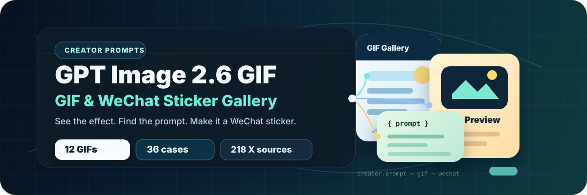
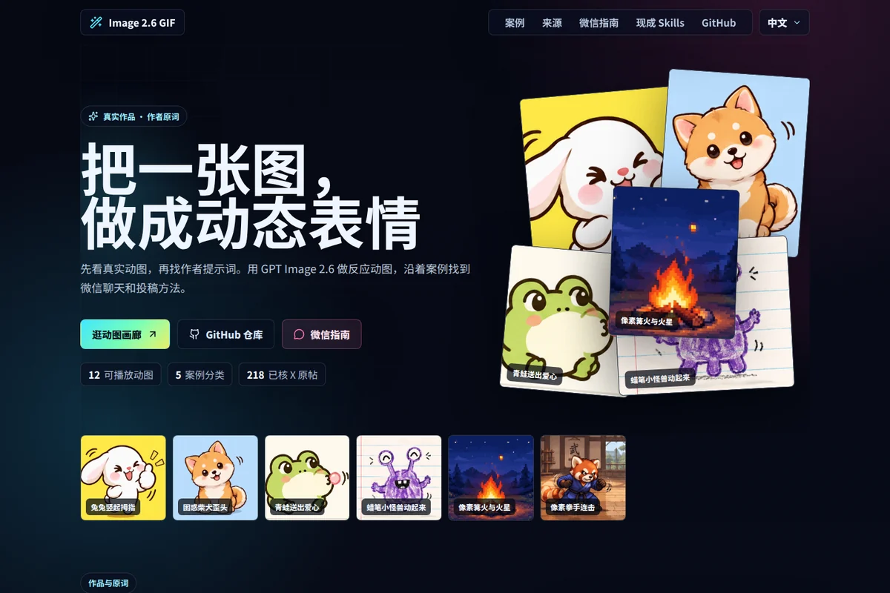
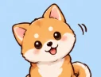
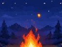
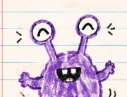
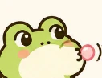

<h1 align="center">Awesome GPT Image 2.6 GIF Stickers</h1>

<strong>Watch real GIFs, find the creator’s prompt, and bring the effect into WeChat.</strong>

  
  
  
  

<a href="README.md">简体中文</a> · <strong>English</strong> <a href="https://dongyu19920904.github.io/awesome-image-2-6-gif/?lang=en">Live gallery</a> · <a href="#case-album">Case album</a> · <a href="#wechat-path">WeChat guide</a> · <a href="SOURCES.md">X source index</a> · <a href="#ready-skills">Skills</a>

**Start with what you have.** [A character image](https://dongyu19920904.github.io/awesome-image-2-6-gif/?category=image_to_gif&lang=en#gallery) · [A GIF to check](guides/wechat.md#prepare) · [A pack to submit](guides/wechat.md#submit)

[See creator-published reference images and native GIFs](guides/reference-gif.md) · [See ten capybara GIFs and the submission materials](guides/wechat.md#submit)

**2026-11-09 update.** Added sourced parameters for 12 GIFs and restored case result and guide links. Start with [the bunny series, its prompts, and the WeChat steps](https://dongyu19920904.github.io/awesome-image-2-6-gif/case/bunny-reaction-set/?lang=en).

**2026-11-11 update.** [Compare and download the 240×240 bunny thumbs-up GIF](guides/wechat.md#bunny-size-check).

## Spotlight · Three reactions from one bunny

Thumbs-up, laughing to tears, and nodding off. Ailingqu uses the same text-described character across three actions. Open any GIF to play it, copy the creator prompt, or switch to another reaction.

<table>
  <tr>
    <td width="33%" valign="top" align="center">
      
<strong>Bunny thumbs-up</strong> Native GIF example

       
      Text-generated · Same series 
      <a href="https://dongyu19920904.github.io/awesome-image-2-6-gif/?case=bunny-reaction-set&amp;lang=en"><strong>Play GIF and see prompt</strong></a>
       <a href="https://github.com/ailingqu/awesome-ai-gif-prompts/blob/a20f88b18a9abe8cd1531fb8a8e738a5a4701ce2/README.md#2-bunny-thumbs-up">Creator prompt</a>
    </td>
    <td width="33%" valign="top" align="center">
      
<strong>Bunny laughing to tears</strong> Native GIF example

       
      Text-generated · Same series 
      <a href="https://dongyu19920904.github.io/awesome-image-2-6-gif/?case=licensed-bunny-laugh&amp;lang=en"><strong>Play GIF and see prompt</strong></a>
       <a href="https://github.com/ailingqu/awesome-ai-gif-prompts/blob/a20f88b18a9abe8cd1531fb8a8e738a5a4701ce2/README.md#3-bunny-laughing-to-tears">Creator prompt</a>
    </td>
    <td width="33%" valign="top" align="center">
      
<strong>Sleepy bunny</strong> Native GIF example

       
      Text-generated · Same series 
      <a href="https://dongyu19920904.github.io/awesome-image-2-6-gif/?case=licensed-bunny-sleepy&amp;lang=en"><strong>Play GIF and see prompt</strong></a>
       <a href="https://github.com/ailingqu/awesome-ai-gif-prompts/blob/a20f88b18a9abe8cd1531fb8a8e738a5a4701ce2/README.md#4-sleepy-bunny">Creator prompt</a>
    </td>
  </tr>
</table>

[Open the series](https://dongyu19920904.github.io/awesome-image-2-6-gif/?case=bunny-reaction-set&lang=en) · [Three prompts and their sources](prompts/bunny-reaction-set.md)

## Live gallery

Search by effect, creator, or prompt, and filter by use or generation route. Pause a GIF, copy the creator prompt when available, or share a case. Reference-image cases link to their creator demonstrations.

## Quick links

| Start with | Open |
| --- | --- |
| A character image | [Blinking and tail movement](prompts/loop-original-sticker-micro-motion.md) · [Waving from a reference](prompts/character-wave-and-smile.md) |
| A finished GIF | [Check looping, legibility, and compression](guides/wechat.md#prepare) · [Dark backgrounds and white edges](prompts/tibetan-fox-dark-mode.md) |
| A sticker pack to submit | [Pack assets and the official portal](guides/wechat.md#submit) · [Ginger cat and capybara creator notes](prompts/ginger-cat-and-capybara.md) |
| A ready-made tool | [Compare requirements for native GIF, finishing, and submission skills](skills/README.md) |

## Case album by category

The 36 gallery cases include 12 playable, licensed GIFs and 24 entries linking to creator sources. Expand the categories for all 27 GitHub case guides. Route labels follow the creator post or source code.

<table>
  <tr>
    <td width="33%" align="center"><a href="https://dongyu19920904.github.io/awesome-image-2-6-gif/?category=image_to_gif&amp;lang=en#gallery"> <strong>Reference and character</strong></a> Find inputs, prompts, and creator demonstrations</td>
    <td width="33%" align="center"><a href="https://dongyu19920904.github.io/awesome-image-2-6-gif/?category=reaction&amp;lang=en#gallery"> <strong>Everyday reactions</strong></a> Pick a gesture that reads at chat size</td>
    <td width="33%" align="center"><a href="https://dongyu19920904.github.io/awesome-image-2-6-gif/?category=loop_technique&amp;lang=en#gallery"> <strong>Loops and micro-motion</strong></a> See local motion, rhythm, and loop seams</td>
  </tr>
  <tr>
    <td width="33%" align="center"><a href="https://dongyu19920904.github.io/awesome-image-2-6-gif/?category=gif_postprocessing&amp;lang=en#gallery"> <strong>GIF finishing</strong></a> Check compression, edges, and chat-size legibility</td>
    <td width="33%" align="center"><a href="https://dongyu19920904.github.io/awesome-image-2-6-gif/?category=wechat_pack&amp;lang=en#gallery"> <strong>WeChat packs and submission</strong></a> Find pack assets and creator submission records</td>
    <td width="33%" align="center"><a href="SOURCES.md"><strong>Find original posts</strong></a> Browse native GIF, WeChat, and assembly sources</td>
  </tr>
</table>

Category covers come from licensed examples. Open each category to see the evidence for its reference images, finishing steps, or submission outcomes.

<strong>Animate an existing image</strong> · 5 cases

- [Animate existing stickers](prompts/animate-existing-stickers.md) · Native GIF request · [@AXIS95277](https://x.com/AXIS95277/status/2118264145824944558)
- [Wave and smile from one image](prompts/character-wave-and-smile.md) · Native GIF request · [@okan_aitool](https://x.com/okan_aitool/status/2118201578406772887)
- [Two references for two reactions](prompts/character-two-reference-reactions.md) · Native GIF request · [@Gimi_min](https://x.com/Gimi_min/status/2118243060064964703)
- [Staff loop and three quality settings](prompts/character-staff-return-loop.md) · Native GIF request · [@Voxyz_ai](https://x.com/Voxyz_ai/status/2118750260549796019)
- [Make a reference character dance](prompts/character-reference-dance.md) · Native GIF request · [@munou_ac](https://x.com/munou_ac/status/2118220485150535796)

<strong>Everyday reactions</strong> · 6 cases

- [Three reactions from one bunny](prompts/bunny-reaction-set.md) · Native GIF request · [@ailingqu](https://github.com/ailingqu/awesome-ai-gif-prompts/blob/a20f88b18a9abe8cd1531fb8a8e738a5a4701ce2/README.md#2-bunny-thumbs-up)
- [Rice reaction](prompts/rice-reaction.md) · Native GIF request · [@Gorden_Sun](https://x.com/Gorden_Sun/status/2118166046175908016)
- [Off work](prompts/off-work.md) · Native GIF request · [@crayon1267](https://x.com/crayon1267/status/2118636908175859897)
- [Bilingual salute loop](prompts/salute-loop.md) · Native GIF request · [@derek_wall90176](https://x.com/derek_wall90176/status/2118175241390436830)
- [Tail-wagging line-art dog](prompts/character-line-dog.md) · Native GIF request · [@CalosLaw](https://x.com/CalosLaw/status/2118199125707547102)
- [Coffee cat and another spec change](prompts/character-coffee-cat-reaction.md) · Native GIF request · [@wolfqing1](https://x.com/wolfqing1/status/2118294955236208942)

<strong>Loops, micro-motion and timing</strong> · 8 cases

- [Watch a narrated 16-frame loop test](prompts/loop-r360-narrated-test.md) · Native GIF request · [@r360studio](https://x.com/r360studio/status/2118843579712123227)
- [Calculate loop duration from frame timing](prompts/loop-duration-math.md) · Route unspecified · [@Superboy4949](https://x.com/Superboy4949/status/2118785150368743814)
- [Compare three falling-apple frame timings](prompts/loop-apple-frame-comparison.md) · Native GIF request · [@rei_aitech](https://x.com/rei_aitech/status/2118245102409908571)
- [A three-second sketch-to-color loop](prompts/loop-sketch-to-color.md) · Native GIF request · [@iijima_no6](https://x.com/iijima_no6/status/2118169220596772927)
- [Keep the lettering in an animated cover](prompts/loop-cover-keeps-lettering.md) · Native GIF request · [@ai_edisonZ](https://x.com/ai_edisonZ/status/2118677271880073230)
- [Add blinks and tail movement to a sticker](prompts/loop-original-sticker-micro-motion.md) · Native GIF request · [@abc123953468547](https://x.com/abc123953468547/status/2118188187193634981)
- [Make a pixel campfire loop with local motion](prompts/licensed-pixel-campfire.md) · Native GIF request · [@ailingqu](https://github.com/ailingqu/awesome-ai-gif-prompts/blob/a20f88b18a9abe8cd1531fb8a8e738a5a4701ce2/README.md#83-pixel-art-campfire)
- [Keep the crayon lines in a doodle monster loop](prompts/licensed-doodle-monster.md) · Native GIF request · [@ailingqu](https://github.com/ailingqu/awesome-ai-gif-prompts/blob/a20f88b18a9abe8cd1531fb8a8e738a5a4701ce2/README.md#64-doodle-monster-comes-alive)

<strong>GIF finishing</strong> · 1 cases

- [Tibetan fox on dark backgrounds](prompts/tibetan-fox-dark-mode.md) · Native GIF and editing · [@vastxie](https://x.com/vastxie/status/2118265895613346263)

<strong>WeChat packs and submission</strong> · 7 cases

- [Ginger cat and capybara packs](prompts/ginger-cat-and-capybara.md) · Pack preparation · [@karanwithai](https://x.com/karanwithai/status/2118190621886165099)
- [Compress and submit a four-frame pack](prompts/wechat-jev-four-frame.md) · Frame assembly · [@jev_chat](https://x.com/jev_chat/status/2118511250275704964)
- [Prepare GIFs and assets for a cat pack](prompts/wechat-zhongying-submission-materials.md) · Pack preparation · [@zhongying14](https://x.com/zhongying14/status/2118326311030591942)
- [Assemble a transparent pack from a 16-cell atlas](prompts/wechat-vane-layered-pack.md) · Frame assembly · [@VaneAILab](https://x.com/VaneAILab/status/2118584425009344644)
- [Preview eight stickers in a ChatGPT project](prompts/wechat-bywind-project-preview.md) · Frame assembly · [@bywind_art](https://x.com/bywind_art/status/2118633386445066345)
- [Go from a direct GIF to a pack deliverable](prompts/wechat-fred-single-to-pack.md) · Mixed workflow · [@Frederickkk07](https://x.com/Frederickkk07/status/2118546394797728093)
- [Use a fixed reference and change the reaction theme](prompts/wechat-luffy-theme-to-submission.md) · Mixed workflow · [@0xluffy_eth](https://x.com/0xluffy_eth/status/2118235549609955443)

## Featured GIFs and prompts

The creator generated these GIFs from text. The first row shows chat reactions, while the second illustrates hand-drawn texture, pixel art, and motion timing.

<table>
  <tr>
    <td width="33%" valign="top" align="center">
      
<strong>Confused shiba head tilt</strong> Native GIF example

       
      A single head tilt reads as confusion. Check whether the expression still reads at chat size. 
      <a href="https://dongyu19920904.github.io/awesome-image-2-6-gif/?case=licensed-shiba-confused&amp;lang=en"><strong>Play GIF and see prompt</strong></a>
       <a href="https://github.com/ailingqu/awesome-ai-gif-prompts/blob/a20f88b18a9abe8cd1531fb8a8e738a5a4701ce2/README.md#6-confused-shiba-head-tilt">Creator prompt</a>
    </td>
    <td width="33%" valign="top" align="center">
      
<strong>Frog blows a heart</strong> Native GIF example

       
      A heart and a small gesture make a thank-you or reaction sticker. 
      <a href="https://dongyu19920904.github.io/awesome-image-2-6-gif/?case=licensed-frog-heart&amp;lang=en"><strong>Play GIF and see prompt</strong></a>
       <a href="https://github.com/ailingqu/awesome-ai-gif-prompts/blob/a20f88b18a9abe8cd1531fb8a8e738a5a4701ce2/README.md#8-frog-blowing-a-heart">Creator prompt</a>
    </td>
    <td width="33%" valign="top" align="center">
      
<strong>Cat typing furiously</strong> Native GIF example

       
      Exaggerated repeated typing makes a busy or replying reaction. 
      <a href="https://dongyu19920904.github.io/awesome-image-2-6-gif/?case=licensed-cat-typing&amp;lang=en"><strong>Play GIF and see prompt</strong></a>
       <a href="https://github.com/ailingqu/awesome-ai-gif-prompts/blob/a20f88b18a9abe8cd1531fb8a8e738a5a4701ce2/README.md#7-cat-typing-furiously">Creator prompt</a>
    </td>
  </tr>
  <tr>
    <td width="33%" valign="top" align="center">
      
<strong>Doodle monster comes alive</strong> Native GIF example

       
      The monster blinks, waves and hops while the ruled paper and drawn lines stay recognizable. 
      <a href="https://dongyu19920904.github.io/awesome-image-2-6-gif/?case=licensed-doodle-monster&amp;lang=en"><strong>Play GIF and see prompt</strong></a>
       <a href="https://github.com/ailingqu/awesome-ai-gif-prompts/blob/a20f88b18a9abe8cd1531fb8a8e738a5a4701ce2/README.md#64-doodle-monster-comes-alive">Creator prompt</a>
    </td>
    <td width="33%" valign="top" align="center">
      
<strong>Pixel campfire and sparks</strong> Native GIF example

       
      Firelight and rising sparks provide localized motion around a stable pixel-art forest. 
      <a href="https://dongyu19920904.github.io/awesome-image-2-6-gif/?case=licensed-pixel-campfire&amp;lang=en"><strong>Play GIF and see prompt</strong></a>
       <a href="https://github.com/ailingqu/awesome-ai-gif-prompts/blob/a20f88b18a9abe8cd1531fb8a8e738a5a4701ce2/README.md#83-pixel-art-campfire">Creator prompt</a>
    </td>
    <td width="33%" valign="top" align="center">
      
<strong>16-bit fighter punch combo</strong> Native GIF example

       
      A side-view punch combo and hit sparks show how a short gesture is timed. 
      <a href="https://dongyu19920904.github.io/awesome-image-2-6-gif/?case=licensed-pixel-punch&amp;lang=en"><strong>Play GIF and see prompt</strong></a>
       <a href="https://github.com/ailingqu/awesome-ai-gif-prompts/blob/a20f88b18a9abe8cd1531fb8a8e738a5a4701ce2/README.md#96-16-bit-fighter-punch-combo">Creator prompt</a>
    </td>
  </tr>
</table>

[Browse all 12 playable GIFs](https://dongyu19920904.github.io/awesome-image-2-6-gif/?lang=en#gallery) · [GIF and prompt data](site/data/gallery-media.json)

## From GIF to WeChat sticker

1. **Make one reaction.** Choose a similar effect and check the input and generation route before opening the creator prompt. [Reference-image case](prompts/animate-existing-stickers.md) · [OpenAI looping GIF guide](https://developers.openai.com/api/docs/guides/image-prompting#generate-a-looping-gif)
2. **View it at chat size.** Check the loop seam, caption, and edges on a dark background. [Add for chat](guides/wechat.md#chat) · [Check and prepare](guides/wechat.md#prepare)
3. **Prepare a pack.** Check the current official requirements, supporting assets, and creator rework examples. [Official submission](guides/wechat.md#submit) · [Review and rework](guides/wechat.md#review)
4. **Check monetization eligibility.** Compare tips, paid packs, and commissioned work by their rules and evidence. [Monetization sources](guides/monetization.md)

## Ready-made skills

| Task | Workflow |
| --- | --- |
| Request one GIF | [varg gpt-image-gif](https://github.com/vargHQ/skills/blob/72e8109188e3366ba8d365902a84d6b237dec1d7/gpt-image-gif/README.md) |
| Make a set one GIF at a time | [varg gpt-image-sticker-pack](https://github.com/vargHQ/skills/blob/72e8109188e3366ba8d365902a84d6b237dec1d7/gpt-image-sticker-pack/README.md) |
| Finish frames or organize pack assets | [ray-sticker-shop](https://github.com/imraywang/ray-sticker-shop/tree/d274a8831b73a9f41504c66d330ca90119582119) · [ban-ge wechat-sticker-pack](https://github.com/ban-ge/wechat-sticker-pack/tree/29656dae1d8024312a5f26bbbe3c8b8d1472613f) |

[Compare all 13 skills, pinned versions, requirements, and outputs](skills/README.md)

## Sources, releases, and contributions

- [222 reviewed X posts](SOURCES.md) are grouped by native GIF, WeChat, frame assembly, and related methods. [Machine-readable index](data/x-materials.json)
- [Case data](data/cases.json) identifies available prompts, documented methods, and the evidence behind listing claims. [Releases](https://github.com/dongyu19920904/awesome-image-2-6-gif/releases)
- Submit a real case with a source, prompt, or media permission, or report a correction. [Contributing](CONTRIBUTING.md) · [GitHub Issues](https://github.com/dongyu19920904/awesome-image-2-6-gif/issues)

## Credits and rights

Homepage GIFs are by ailingqu under CC BY 4.0. The banner and README structure are adapted from freestylefly’s open-source project, and the media case format draws on yihui-dev’s Opus collection. See each source for reuse terms. [Credits and rights](LICENSES.md) · [Upstream MIT license](site/LICENSE)
