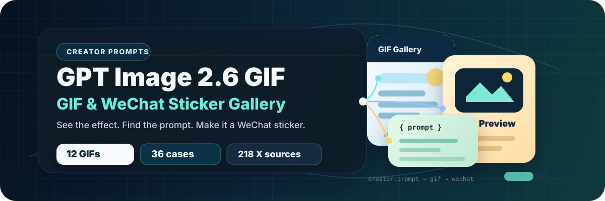
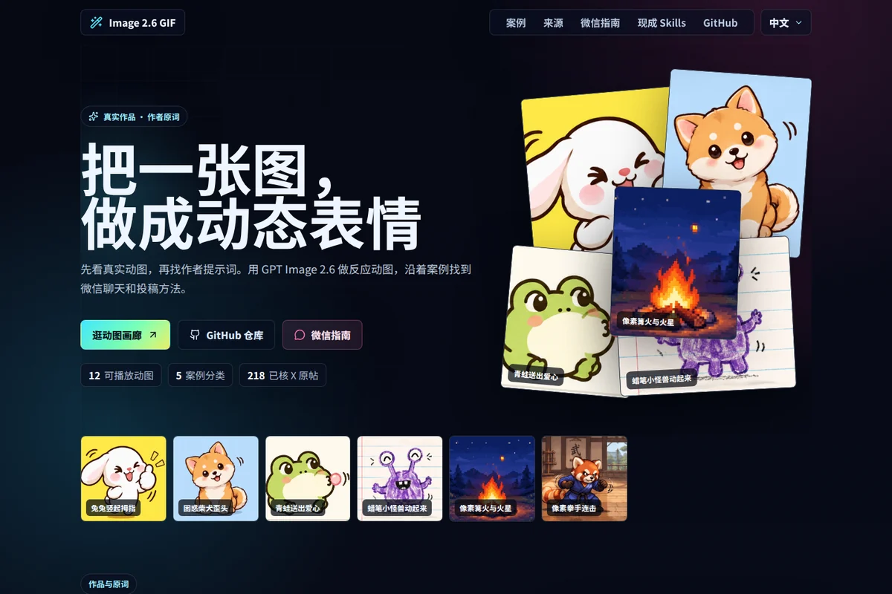

<h1 align="center">GPT Image 2.6 GIF 表情包大全</h1>

<strong>看真实动图，找作者原词，把喜欢的效果带进微信聊天。</strong>

  
  
  
  

<strong>简体中文</strong> · <a href="README.en.md">English</a> <a href="https://dongyu19920904.github.io/awesome-image-2-6-gif/">在线画廊</a> · <a href="#case-album">分类案例</a> · <a href="#wechat-path">微信路线</a> · <a href="SOURCES.md">来源索引</a> · <a href="#ready-skills">现成 Skills</a>

## 专题 · 同一只兔子的三种反应

点赞、笑出眼泪、困得点头。三个动图来自 ailingqu 的同一角色系列，沿用文字角色设定，分别换动作。点任意一张可播放、复制作者原词，再切到同组作品。

<table>
  <tr>
    <td width="33%" valign="top" align="center">
      
<strong>兔兔竖起拇指</strong> 原生 GIF 示例

       
      文字描述生成 · 同系列 
      <a href="https://dongyu19920904.github.io/awesome-image-2-6-gif/?case=bunny-reaction-set"><strong>看动图与原词</strong></a>
       <a href="https://github.com/ailingqu/awesome-ai-gif-prompts/blob/a20f88b18a9abe8cd1531fb8a8e738a5a4701ce2/README.md#2-bunny-thumbs-up">作者原词</a>
    </td>
    <td width="33%" valign="top" align="center">
      
<strong>兔兔笑出眼泪</strong> 原生 GIF 示例

       
      文字描述生成 · 同系列 
      <a href="https://dongyu19920904.github.io/awesome-image-2-6-gif/?case=licensed-bunny-laugh"><strong>看动图与原词</strong></a>
       <a href="https://github.com/ailingqu/awesome-ai-gif-prompts/blob/a20f88b18a9abe8cd1531fb8a8e738a5a4701ce2/README.md#3-bunny-laughing-to-tears">作者原词</a>
    </td>
    <td width="33%" valign="top" align="center">
      
<strong>兔兔困得点头</strong> 原生 GIF 示例

       
      文字描述生成 · 同系列 
      <a href="https://dongyu19920904.github.io/awesome-image-2-6-gif/?case=licensed-bunny-sleepy"><strong>看动图与原词</strong></a>
       <a href="https://github.com/ailingqu/awesome-ai-gif-prompts/blob/a20f88b18a9abe8cd1531fb8a8e738a5a4701ce2/README.md#4-sleepy-bunny">作者原词</a>
    </td>
  </tr>
</table>

[打开整组专题](https://dongyu19920904.github.io/awesome-image-2-6-gif/?case=bunny-reaction-set) · [三个原词与出处](prompts/bunny-reaction-set.md)

## 在线画廊

按效果、作者或原词搜索，按用途与生成路线筛选。案例可暂停、复制原词和分享；已经有角色图的读者可以从参考图案例看作者演示。

## 快速入口

| 你手头有什么 | 从这里开始 |
| --- | --- |
| 一张角色图 | [原图眨眼与摆尾](prompts/loop-original-sticker-micro-motion.md) · [挥手微笑的参考图案例](prompts/character-wave-and-smile.md) |
| 一段已经生成的 GIF | [检查循环、清晰度与压缩](guides/wechat.md#prepare) · [深色背景与白边](prompts/tibetan-fox-dark-mode.md) |
| 一套想投稿的表情 | [专辑材料和官方入口](guides/wechat.md#submit) · [橘猫和水豚的作者记录](prompts/ginger-cat-and-capybara.md) |
| 想找一套现成工具 | [查看原生 GIF、后处理和投稿 Skills 的使用条件](skills/README.md) |

## 案例分类总览

36 个画廊案例包括 12 个可直接播放的授权 GIF 和 24 个原帖入口。下方按用途展开 27 个 GitHub 导读，路线标签以作者原文或源码为据。

<strong>已有图片怎么动起来</strong> · 5 个案例

- [让已有表情图动起来](prompts/animate-existing-stickers.md) · 原生 GIF 请求 · [@AXIS95277](https://x.com/AXIS95277/status/2118264145824944558)
- [单张角色图挥手微笑](prompts/character-wave-and-smile.md) · 原生 GIF 请求 · [@okan_aitool](https://x.com/okan_aitool/status/2118201578406772887)
- [双参考图做两种反应](prompts/character-two-reference-reactions.md) · 原生 GIF 请求 · [@Gimi_min](https://x.com/Gimi_min/status/2118243060064964703)
- [挥杖回位与三档质量对照](prompts/character-staff-return-loop.md) · 原生 GIF 请求 · [@Voxyz_ai](https://x.com/Voxyz_ai/status/2118750260549796019)
- [参考角色图变跳舞 GIF](prompts/character-reference-dance.md) · 原生 GIF 请求 · [@munou_ac](https://x.com/munou_ac/status/2118220485150535796)

<strong>日常表情与角色反应</strong> · 6 个案例

- [同一只兔子的三种反应](prompts/bunny-reaction-set.md) · 原生 GIF 请求 · [@ailingqu](https://github.com/ailingqu/awesome-ai-gif-prompts/blob/a20f88b18a9abe8cd1531fb8a8e738a5a4701ce2/README.md#2-bunny-thumbs-up)
- [吃米饭「真香」](prompts/rice-reaction.md) · 原生 GIF 请求 · [@Gorden_Sun](https://x.com/Gorden_Sun/status/2118166046175908016)
- [下班啦](prompts/off-work.md) · 原生 GIF 请求 · [@crayon1267](https://x.com/crayon1267/status/2118636908175859897)
- [双语敬礼循环](prompts/salute-loop.md) · 原生 GIF 请求 · [@derek_wall90176](https://x.com/derek_wall90176/status/2118175241390436830)
- [线条小狗摇尾巴](prompts/character-line-dog.md) · 原生 GIF 请求 · [@CalosLaw](https://x.com/CalosLaw/status/2118199125707547102)
- [橘猫咖啡杯与「需求又改了」](prompts/character-coffee-cat-reaction.md) · 原生 GIF 请求 · [@wolfqing1](https://x.com/wolfqing1/status/2118294955236208942)

<strong>循环、微动作与参数</strong> · 8 个案例

- [看 16 帧循环的完整试做](prompts/loop-r360-narrated-test.md) · 原生 GIF 请求 · [@r360studio](https://x.com/r360studio/status/2118843579712123227)
- [用帧数和帧时长算循环](prompts/loop-duration-math.md) · 生成路线未说明 · [@Superboy4949](https://x.com/Superboy4949/status/2118785150368743814)
- [苹果下落的三档帧时长](prompts/loop-apple-frame-comparison.md) · 原生 GIF 请求 · [@rei_aitech](https://x.com/rei_aitech/status/2118245102409908571)
- [草图到上色的三秒循环](prompts/loop-sketch-to-color.md) · 原生 GIF 请求 · [@iijima_no6](https://x.com/iijima_no6/status/2118169220596772927)
- [封面图做循环时保留原字](prompts/loop-cover-keeps-lettering.md) · 原生 GIF 请求 · [@ai_edisonZ](https://x.com/ai_edisonZ/status/2118677271880073230)
- [只给原图加眨眼和摆尾](prompts/loop-original-sticker-micro-motion.md) · 原生 GIF 请求 · [@abc123953468547](https://x.com/abc123953468547/status/2118188187193634981)
- [像素篝火只动火焰和火星](prompts/licensed-pixel-campfire.md) · 原生 GIF 请求 · [@ailingqu](https://github.com/ailingqu/awesome-ai-gif-prompts/blob/a20f88b18a9abe8cd1531fb8a8e738a5a4701ce2/README.md#83-pixel-art-campfire)
- [蜡笔小怪兽保留线条与纸纹](prompts/licensed-doodle-monster.md) · 原生 GIF 请求 · [@ailingqu](https://github.com/ailingqu/awesome-ai-gif-prompts/blob/a20f88b18a9abe8cd1531fb8a8e738a5a4701ce2/README.md#64-doodle-monster-comes-alive)

<strong>动图适配与后处理</strong> · 1 个案例

- [藏狐的深色底白边](prompts/tibetan-fox-dark-mode.md) · 原生 GIF 加后处理 · [@vastxie](https://x.com/vastxie/status/2118265895613346263)

<strong>微信表情专辑与投稿</strong> · 7 个案例

- [橘猫与水豚专辑](prompts/ginger-cat-and-capybara.md) · 专辑物料与投稿 · [@karanwithai](https://x.com/karanwithai/status/2118190621886165099)
- [四帧表情的压缩与投稿](prompts/wechat-jev-four-frame.md) · 帧合成 · [@jev_chat](https://x.com/jev_chat/status/2118511250275704964)
- [猫咪专辑的 GIF 与配套材料](prompts/wechat-zhongying-submission-materials.md) · 专辑物料与投稿 · [@zhongying14](https://x.com/zhongying14/status/2118326311030591942)
- [十六格动作图集与透明合成](prompts/wechat-vane-layered-pack.md) · 帧合成 · [@VaneAILab](https://x.com/VaneAILab/status/2118584425009344644)
- [ChatGPT 项目里的八款表情预览](prompts/wechat-bywind-project-preview.md) · 帧合成 · [@bywind_art](https://x.com/bywind_art/status/2118633386445066345)
- [从单张原生动图到一套交付](prompts/wechat-fred-single-to-pack.md) · 混合路线 · [@Frederickkk07](https://x.com/Frederickkk07/status/2118546394797728093)
- [固定角色母图，再按主题做一套](prompts/wechat-luffy-theme-to-submission.md) · 混合路线 · [@0xluffy_eth](https://x.com/0xluffy_eth/status/2118235549609955443)

## 精选动图与原词

这些动图由作者用文字生成。前一排适合聊天反应，后一排适合观察手绘、像素和动作节奏。

<table>
  <tr>
    <td width="33%" valign="top" align="center">
      
<strong>困惑柴犬歪头</strong> 原生 GIF 示例

       
      一个歪头动作就能表达疑惑，适合检查缩小后神态是否清楚。 
      <a href="https://dongyu19920904.github.io/awesome-image-2-6-gif/?case=licensed-shiba-confused"><strong>看动图与原词</strong></a>
       <a href="https://github.com/ailingqu/awesome-ai-gif-prompts/blob/a20f88b18a9abe8cd1531fb8a8e738a5a4701ce2/README.md#6-confused-shiba-head-tilt">作者原词</a>
    </td>
    <td width="33%" valign="top" align="center">
      
<strong>青蛙送出爱心</strong> 原生 GIF 示例

       
      用爱心和简单的动作做感谢或回应。 
      <a href="https://dongyu19920904.github.io/awesome-image-2-6-gif/?case=licensed-frog-heart"><strong>看动图与原词</strong></a>
       <a href="https://github.com/ailingqu/awesome-ai-gif-prompts/blob/a20f88b18a9abe8cd1531fb8a8e738a5a4701ce2/README.md#8-frog-blowing-a-heart">作者原词</a>
    </td>
    <td width="33%" valign="top" align="center">
      
<strong>猫咪疯狂打字</strong> 原生 GIF 示例

       
      夸张重复的打字动作适合做忙碌或正在回复的反应。 
      <a href="https://dongyu19920904.github.io/awesome-image-2-6-gif/?case=licensed-cat-typing"><strong>看动图与原词</strong></a>
       <a href="https://github.com/ailingqu/awesome-ai-gif-prompts/blob/a20f88b18a9abe8cd1531fb8a8e738a5a4701ce2/README.md#7-cat-typing-furiously">作者原词</a>
    </td>
  </tr>
  <tr>
    <td width="33%" valign="top" align="center">
      
<strong>蜡笔小怪兽动起来</strong> 原生 GIF 示例

       
      怪兽眨眼、挥手和跳动，横线纸和手绘笔触仍保留。 
      <a href="https://dongyu19920904.github.io/awesome-image-2-6-gif/?case=licensed-doodle-monster"><strong>看动图与原词</strong></a>
       <a href="https://github.com/ailingqu/awesome-ai-gif-prompts/blob/a20f88b18a9abe8cd1531fb8a8e738a5a4701ce2/README.md#64-doodle-monster-comes-alive">作者原词</a>
    </td>
    <td width="33%" valign="top" align="center">
      
<strong>像素篝火与火星</strong> 原生 GIF 示例

       
      用火焰和上升的火星做局部动效，保留周围像素森林。 
      <a href="https://dongyu19920904.github.io/awesome-image-2-6-gif/?case=licensed-pixel-campfire"><strong>看动图与原词</strong></a>
       <a href="https://github.com/ailingqu/awesome-ai-gif-prompts/blob/a20f88b18a9abe8cd1531fb8a8e738a5a4701ce2/README.md#83-pixel-art-campfire">作者原词</a>
    </td>
    <td width="33%" valign="top" align="center">
      
<strong>像素拳手连击</strong> 原生 GIF 示例

       
      侧视拳手的连击和火花适合观察短动作的节奏。 
      <a href="https://dongyu19920904.github.io/awesome-image-2-6-gif/?case=licensed-pixel-punch"><strong>看动图与原词</strong></a>
       <a href="https://github.com/ailingqu/awesome-ai-gif-prompts/blob/a20f88b18a9abe8cd1531fb8a8e738a5a4701ce2/README.md#96-16-bit-fighter-punch-combo">作者原词</a>
    </td>
  </tr>
</table>

[看全部 12 张可播放动图](https://dongyu19920904.github.io/awesome-image-2-6-gif/#gallery) · [动图与原词数据](site/data/gallery-media.json)

## 从 GIF 到微信表情

1. **做一张。** 先选相近效果，核对输入条件和生成路线，再打开作者原词。 [参考图案例](prompts/animate-existing-stickers.md) · [OpenAI 循环 GIF 指南](https://developers.openai.com/api/docs/guides/image-prompting#generate-a-looping-gif)
2. **在聊天里看。** 缩到手机实际大小，检查首尾衔接、字幕和深色边缘。 [聊天添加](guides/wechat.md#chat) · [检查与适配](guides/wechat.md#prepare)
3. **做整套并准备投稿。** 核对当前官方规范、配套材料和返工案例。 [官方投稿入口](guides/wechat.md#submit) · [审核与返工](guides/wechat.md#review)
4. **查变现条件。** 分开看赞赏、付费专辑和品牌定制的资格、案例和收入证据。 [变现资料](guides/monetization.md)

## 现成 Skills

| 任务 | 可查看的工作流 |
| --- | --- |
| 直接请求单张 GIF | [varg gpt-image-gif](https://github.com/vargHQ/skills/blob/72e8109188e3366ba8d365902a84d6b237dec1d7/gpt-image-gif/README.md) |
| 逐张做同角色表情 | [varg gpt-image-sticker-pack](https://github.com/vargHQ/skills/blob/72e8109188e3366ba8d365902a84d6b237dec1d7/gpt-image-sticker-pack/README.md) |
| 已有动作帧或需要整理投稿材料 | [ray-sticker-shop](https://github.com/imraywang/ray-sticker-shop/tree/d274a8831b73a9f41504c66d330ca90119582119) · [半格 wechat-sticker-pack](https://github.com/ban-ge/wechat-sticker-pack/tree/29656dae1d8024312a5f26bbbe3c8b8d1472613f) |

[对照 13 个 Skills 的固定版本、依赖与输出](skills/README.md)

## 来源、更新与贡献

- [218 条已核 X 原帖](SOURCES.md)按原生 GIF、微信、帧合成及其他方法分组，逐条保留作者和出处。 [机器可读数据](data/x-materials.json)
- [案例数据](data/cases.json)标明原帖提供了完整原词、操作方法还是工作流，也记录上架信息的证据来源。 [版本记录](https://github.com/dongyu19920904/awesome-image-2-6-gif/releases)
- 欢迎提供带原帖、原词或明确展示许可的真实案例，也欢迎更正路线与作者信息。 [贡献说明](CONTRIBUTING.md) · [GitHub Issues](https://github.com/dongyu19920904/awesome-image-2-6-gif/issues)

## 署名与许可

首页动图由 ailingqu 发布，采用 CC BY 4.0。首页横幅和章节组织沿用 freestylefly 的开源项目，媒体案例结构也参考了 yihui-dev 的 Opus 视频库。第三方作品的复用条件见各自来源。 [署名与许可](LICENSES.md) · [上游 MIT 许可](site/LICENSE)
